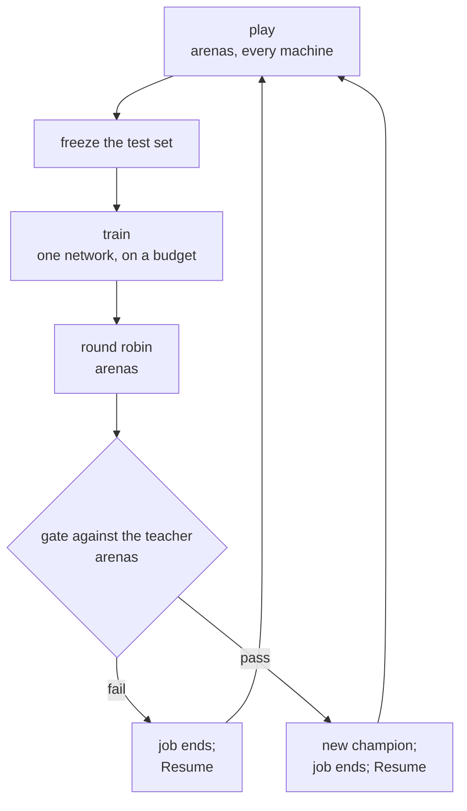

# Developing Fattorini

For what Fattorini is and how to run it, see [README.md](README.md).

Fattorini is developed on Windows only, from **Git Bash** (it comes with Git for Windows), never
PowerShell or cmd. Development also requires **Google Drive for desktop**, with My Drive on `G:`:
what the machines share, such as Lc0's converted games, lives in `G:/My Drive/fattorini`, and the scripts
and binaries read and write it there.

## The workspace

The repository holds the engine, an arena that plays engines against each other, and a trainer for
their networks. Three binaries, each with its own crate:

- `fattorini`, the engine.
- `arena`, which plays games: matches, and, as one of the smithy's arenas, every game of a forge or
  a tune.
- `smithy`, which makes the sources' corpora and trains networks (the smithy, dealing its jobs to
  the arenas), and inspects checkpoints. Training needs an NVIDIA GPU.

And one library, `pgn-replay`, which reads PGN moves for `arena` and `smithy`.

Run every binary through its script in `bin/`, which builds it when needed and runs it from the
repository root:

```bash
./bin/fattorini
```

## One generation

`configs/` holds two kinds of config. A **source** makes one corpus, once, on Drive, for every forge
named after it:

- `lc0.yaml`: Lc0's training tars, converted by its Convert job (`data/lc0/`), up to its cap.
- `pesto.yaml`: the PeSTO evaluation's self-play at depth 9, played by its Play job (`data/pesto/`), to
  its `training_positions`; it also holds `pesto`'s `tune:`.

Each also sizes its frozen test set, `test_positions`. A **forge**, `<source>-<architecture>`
(`lc0-psq`, `pesto-psq`), is a network trained by one job of the smithy, on the GPU machine: one
file holding its sizes from generation 2 on and its gate (`training_positions`,
`test_positions`, `round_robin_pairs`, `gate_elo_d`), its generations' `tune:`
(below) and its network's `labels:` (its source), `architecture:` and `training:`. Every job starts
from the smithy's page, and every game is played by the arenas, `arena start`, one on every machine,
over HTTP on the local network.

A config can be forged more than once: each time is an **attempt**, numbered from 1, in
`data/networks/<config>/attempt-<n>/` with its own copy of the config as it started, `config.yaml`,
so editing `configs/` changes only new attempts. Every phase resumes from the attempt's files.
Attempt n is named `<config>-a<n>`, the first included (`pesto-psq-a1`, `pesto-psq-a2`). A network
is named by its config, then each part marked by a letter, the attempt always and last:

- a generation's winner, `<config>-g<g>-a<n>`: `pesto-psq-g1-a1`;
- its candidate, `<config>-g<g>-lpolyline-a<n>`: `pesto-psq-g1-lpolyline-a1`. The `lpolyline` names
  the labels the run trains at; the grid's candidates, `-l<lambda>` with two decimals, were refused
  when the grid was removed (2026-11-26).

Attempts were called runs until 2026-11-19 (`-r<n>`, `run-<n>/`, `run_config.txt`); every `data/`
and Drive were migrated then, and the old names are refused.

A generation has at most one winner, so the winner's name leaves the `lpolyline` out. A player is a network with what it plays with, always written after an `@`: `@untuned`,
the defaults; `@search-tuned`, its search tune and the default clock; or `@search-time-tuned`, its
search and time tunes (`pesto-psq-g1-a1@search-tuned`, `pesto@untuned`). A suffix whose tune is
missing is refused. Only a generation's winner is tuned.

**Generation 1** trains on its source's whole corpus, judged on the source's whole frozen test set,
with no play phase, and refuses to start until the corpus is complete; the attempt records the sizes
in its `corpus.txt`. Its winner is gated against the PeSTO evaluation once: a fail ends the attempt, since
it says the network is wrong; a pass makes it generation 2's teacher.

From **generation 2** on, each generation has a **teacher**, the last champion, and runs unattended:

1. **Play.** The arenas play the teacher against itself, searching each position at depth 9: the
   test games first, then the training games, the training set (`training_positions`, 1024 x 1024 x
   1024 in every config).
2. **Test set.** The smithy draws the fixed test set the training is judged on from the test games,
   once, and keeps it on disk.
3. **Training.** The smithy trains one network on a fixed budget, `epochs` passes over the training
   set, the rate falling geometrically between `learning_rate`'s two values. Each label blends a
   position's search score with the game's result, weighted by lambda, which follows the polyline:
   ten values, one per tenth of a game, measured on the corpus.
4. **Round robin.** The arenas play the budget's kept checkpoints (every quarter epoch from half
   the budget to its end) against each other; the best is the candidate, and the winner.
5. **Gate.** The arenas play the winner against the teacher, an SPRT. A pass makes it the new
   champion and the next generation's teacher, which starts when the developer presses the attempt's
   Resume; a fail ends the attempt (its phase `stopped`), and a new attempt starts over.

A transformer, which the engine cannot play yet, ends at its training.

The smithy runs at most two jobs at once: Lc0's Convert, which uses neither the arenas nor the GPU,
beside one arena job (a forge, a tune, or PeSTO's Play). Each has its own Stop; Convert's abandons
the tar in flight, redone next time.



## Setting up a machine

Once, on every machine.

Build tools and Rust, then a new terminal:

```bash
winget install --id Microsoft.VisualStudio.2022.BuildTools --override "--passive --wait --add Microsoft.VisualStudio.Workload.VCTools --includeRecommended"
```

```bash
winget install --id Rustlang.Rustup
```

For full speed, exclude the repository, `%USERPROFILE%\.cargo` and
`%USERPROFILE%\.rustup` from Microsoft Defender, and set Windows' power mode to Best performance.

A name for the machine, lowercase letters and digits, different on every machine:

```bash
echo 'name: <name>' > data/machine.yaml
```

The external engines it may play, Stockfish first; then set each `path` in the copy:

```bash
cp examples/engines.yaml data/engines.yaml
```

The opening positions and the Syzygy tablebases (about 150 GB), into the repository's `data/`:

```bash
./bin/uho-book.sh
```

```bash
./bin/syzygy.sh
```

Google Drive for desktop, in streaming mode with My Drive on `G:`, on every machine, the arenas'
included: Drive is Fattorini's store, `G:/My Drive/fattorini`, the same tree as the repository's `data/`. A file
is made on the local disk and reaches Drive only whole, never written or appended there in place:

- an attempt's networks (every candidate, every teacher) as soon as they are complete; the arenas read
  them from Drive by their path there, waiting for one not yet visible on their machine, and giving
  its chore back after 30 minutes;
- an attempt's living files (its state, logs, records) as whole copies at every phase boundary, so a dead
  local disk loses at most one phase;
- a closed generation's directory, moved whole, its local copy deleted;
- a tune's files every 15 minutes, then the whole tune beside its network at its end;
- the sources' corpora, segment by segment.

Every reader (`arena duel`, a snapshot, the page's View) looks on the local disk
first, then on Drive. Folders may be made available offline in Drive's settings to read them faster.

A Python environment named `.fattorini` with PyTorch, for `smithy`: on the GPU machine to train, and
on any other machine that runs `smithy` or its tests:

```bash
winget install --id astral-sh.uv
```

```bash
uv venv .fattorini --python 3.14
```

```bash
source .fattorini/Scripts/activate
```

```bash
uv pip install "torch==2.11.0" numpy --torch-backend=auto
```

On a machine without an NVIDIA GPU (to run `smithy`'s tests), name the CPU
backend instead of `auto`:

```bash
uv pip install "torch==2.11.0" numpy --torch-backend=cpu
```

`auto` picks the build from the graphics hardware it finds, and on any Intel GPU, however old,
it installs the XPU build (`2.11.0+xpu`). Python imports it, but `smithy` links `c10.dll` directly,
and on an Intel GPU the XPU build does not support, that DLL fails to load: every `smithy` binary,
tests included, dies on `c10.dll` though the file is there (2026-10-15).
`python -c "import torch; print(torch.__version__)"` must end in `+cu...` on the GPU machine and in
`+cpu` everywhere else.

Activate it before every `./bin/smithy`. Its GPU commands print `device = Cuda(0)` first: if they
don't, it is training on the CPU.

## Jobs: the smithy and the arenas

The smithy (`smithy`) runs one job at a time, a forge or a tune, and deals it as chores to
the arenas (`arena`), at most one on every machine, each chore a number of tasks: a game, or a pair
of games on one opening. A smithy runs on any machine: a full attempt trains only where a CUDA GPU
is, and the page greys it out elsewhere, saying so; a scaled attempt (below) trains on the CPU. Several
smithies may run at once, each arena playing for the one whose claim it holds.
`data/machines.yaml` on Google Drive lists every machine, highest rank first: a smithy claims the
arena of each, and between two jobs of the same kind (full or scaled) the higher-ranked smithy keeps
the arenas. Written once, on Drive, so every machine reads the same copy.
Its shape is `examples/machines.yaml`'s:

```bash
cp examples/machines.yaml "/g/My Drive/fattorini/data/machines.yaml"
```

Then the names in that copy edited, and `router` set to the home router's MAC address, as Git Bash
shows it on the home network (the default gateway, then its address):

```bash
ipconfig | grep -i "default gateway"
```

```bash
arp -a <default gateway>
```

The address goes on Drive only, never in the repository; the placeholder is refused. A local `data/machines.yaml` is no longer read; the older
`smithy:` and `arenas:` are refused, the smithy saying the form to write.

The smithy, in its own terminal, left running: it starts with no job, and claims every listed
machine's arena that answers, unclaimed, whatever its commit: the Machines table says when an arena's
commit differs from the smithy's, for the developer to judge. A machine that fails (off, no arena,
held by another smithy) is tried again after 10 s, then after waits doubling
up to 5 minutes while it keeps failing the same way; the page's Machines table says why, and when the
next try is.

```bash
./bin/smithy start
```

Jobs are started and stopped from its page, opened in a browser on that same machine,
`http://127.0.0.1:47821/`. The page lists every forge config with every attempt of it: View shows
any generation of an attempt, never resuming it; Resume continues an attempt that has not ended; New
attempt starts the config afresh. Under an attempt, each generation whose winner passed its gate can
be tuned (below), by hand, whether the attempt has ended or waits; `pesto` always can. One job at a time; when it ends, its result stays
on the page until the next one starts, without restarting the smithy. The page opened from another
machine shows the same, read-only.

On every machine that should play, an arena, started by hand in its own terminal, left running: it
idles until a smithy claims it, then plays for that smithy alone. A smithy claims arenas only while
its job deals games (a forge's play, round robin and gate, a tune, a test, PeSTO's play) and
releases them after 60 s dealing none, so another smithy's job plays meanwhile. When two smithies want one arena, a full job's claim takes it from a scaled
job's, and between jobs of the same kind the smithy ranked higher in `machines.yaml` takes it; a
job left with no arena says it waits, and the Machines table names each holder by its rank. A smithy polls its arenas every
10 s: one unanswering for 30 s is late, for 60 s lost, its chore dealt again. An arena unpolled for
60 s releases itself and idles, claimable again; tasks it finished meanwhile wait in memory and go
to the same smithy when it claims the arena back. A restarted smithy claims its arenas back at once.
Closing an arena withdraws its machine.

```bash
./bin/arena start
```

From another terminal on the same machine, what each is doing, or a stop (the smithy's stops its
job at its next safe point, then itself; the arena's at once, its chore handed out again):

```bash
./bin/smithy status
```

```bash
./bin/arena status
```

```bash
./bin/smithy stop
```

```bash
./bin/arena stop
```

Any browser on the local network shows the job as it goes, read-only, at the smithy machine's
address on that port, `http://<machine>:47821/` (`smithy status` prints it). Only `smithy stop` or Ctrl+C ends the smithy.

The smithy listens on TCP port 47821, an arena on 47823, each on `127.0.0.1` and on its machine's
LAN address. Every machine's firewall must allow both, once, below. Each listens on its machine's
LAN address as it was at its start: after the machine changes network, stop and start it again to
reach the other machines.

Both serve the LAN only on the home network, recognized by its router (`machines.yaml`'s
`router`), looked at again every 10 s. Away, on any other network, where a machine may by chance be
named as one of ours, they talk to their own machine alone: the LAN listeners refuse every request,
no other machine is claimed or asked for a lease, and the smithy claims its own machine's arena over
`127.0.0.1`. Back home, the other machines are claimed again.

A stopped attempt resumes where it stopped with its Resume, on this smithy or any other: several
smithies may run at once, on any machines, but a job runs in one only. A forge attempt, a tune, PeSTO's
play, Lc0's Convert and the first freeze of a source's test set each hold a lease, in the memory of
the smithy running the job. Starting one asks every other machine's smithy over the LAN (port
47821), once, and waits for nothing: the job is refused while another smithy runs it, for 2 minutes
after another stopped it (Drive syncing its last files), or when another smithy's build is too old
to ask. A machine that does not answer is taken as off. To move a job, stop it where it runs, then
resume it on the other machine. The `lease.txt` files older builds left on Drive are ignored and may
be deleted. A forge attempt's open generation and state
are copied to Drive when it stops and every 30 minutes of training, and a Resume elsewhere copies
them down. Full attempts train only where CUDA is: on a machine without it, the page says so and
offers scaled attempts alone.

An NNUE forge trains on its training set fully shuffled: its training first scatters the training set into
`data/buckets/` on the smithy's local disk: once per source for generation 1 (about 15 GB for Lc0's,
shared by every `lc0-` forge; PeSTO's likewise), and about 15 GB per self-play generation after. A disposable cache: deleting it costs only a new scatter. The run keeps the budget's candidate checkpoints and its
latest round's (the others are deleted after every round).

## Scaled attempts

For development, on any machine, a GPU or not: an attempt started with the page's New scaled
attempt, at a fixed factor s of 1024 (`scale::DEFAULT`), every phase in minutes, nothing about
strength. Data volumes and the work of a round divide by s, game counts by its square root, the
search's depth loses log2(s) / 2 plies, each down to a floor that keeps its phase meaningful; the
attempt's shape (the budget's epochs and rates, the gate's rules) stays the config's. The scale is
frozen into the attempt's own `config.yaml` (`scale: <s>`) and marked on the page wherever the
attempt is named.

A scaled attempt is an attempt like any other, numbered with the full ones and saved to Drive as they are. On a
source, it reads a 1/s share of the corpus, its first training files, scattered into buckets of
their own (`data/buckets/lc0-s1024`), and a fixed subset of the source's frozen test set: sources
are never scaled. Its networks play in their attempt alone: never snapshotted nor a side of a trial, and tuned
only by a tune scaled as their attempt, to debug the tune itself.

## Matches

```bash
./bin/arena duel pesto@untuned pesto-psq-g1-a1@search-tuned --time 10+0.1
```

- `match <a> <b> [<n>]`: a best of n games, 400 by default, stopped once decided; `--full` plays
  all n, so the score is always over n.
- `sprt <a> <b> <elo>`: whether b is at least that many Elo stronger.
- `duel <a> <b>`: until one is shown stronger, or 800 games (400 pairs).

Each needs `--depth <d>` or `--time <base+inc>`. A player is a Fattorini player, `pesto` or a forge attempt's
network (`pesto-psq-g1-a1`, `pesto-psq-g1-lpolyline-a2`), always followed by `@untuned`,
`@search-tuned` or `@search-time-tuned`; or `stockfish-<level>` (0 to 20), `stockfish-elo-<rating>`, or another engine of
`data/engines.yaml`, with no suffix. Against an external engine, the Fattorini player plays over
UCI: the arena first builds it with its network and parameters embedded, as a snapshot, into
`target/uci-players/`.

## Snapshots

A snapshot is a release build of `fattorini` with a player's network and parameters embedded:

```bash
./bin/arena snapshot pesto-psq-g1-a1@search-tuned
```

The player is `pesto` or a full attempt's generation winner, with its suffix. The snapshot is
written straight to Drive, never locally:
`/g/My Drive/fattorini/data/snapshots/fattorini-<player>-<suffix>-<YYYYMMDD-HHMM>.exe`
(UTC). A new snapshot replaces the older ones of the same player and suffix, so lichess-bot's
`config.yml` must then name the new file. No smithy nor running arena is needed. The engine has no option choosing a network: it plays what it
embeds. `fattorini about` and a first `info string` say exactly what it is: the player, the
commit and when (`pesto@untuned 7b89e3f-dirty 2026-11-06 09:36 UTC`); its UCI name is only
`Fattorini <version>-dev`, since a rating list's PGNs carry that name whole, and only a release
(below) drops the `-dev`. lichess-bot's
`config.yml` names the snapshot it plays. A release on GitHub is built the same way.

## The opening book

The book lichess-bot plays is grown from the initial position by a UCI engine of
`data/engines.yaml` (Stockfish: its `wdl` gives the expected scores), in fragments: Dijkstra over
the game graph, each move costing 10 plus its loss in expected-score points, a move losing 7
points or more never admitted, a decided position (beyond +/-3.00, or a mate) never expanded.
Fragment 0 holds the positions of cost up to 120 (12 plies of best moves), each next fragment 10
more. Three commands of the smithy, run by hand, in no usage line.

Before a run, how one position expands (every search, its score, loss, nodes and time; nothing
written), here after 1. e4 e5 2. Nf3 Nc6 3. Bb5 a6:

```bash
./bin/smithy book-probe stockfish e2e4 e7e5 g1f3 b8c6 f1b5 a7a6
```

The next fragment, one engine per core, each search at depth 20 on one thread; stopped by Ctrl+C
or a crash, the same command resumes, and earlier fragments are never searched again:

```bash
./bin/smithy book-fragment stockfish
```

It writes `data/books/book-stockfish-f<k>.bin`. Then the Polyglot book of every fragment so far,
each move weighing e^(score / T) against its position's best, T = 20 cp unless `--temperature`
says otherwise:

```bash
./bin/smithy book-polyglot stockfish
```

It writes `data/books/book-stockfish-f0-<k>-t20.bin`, which lichess-bot's `config.yml` names.

## Releases

A release is a snapshot built at a tag: the C runtime static, the third-party notices embedded
(`fattorini licenses`), uploaded to GitHub as a draft. Only the `.exe` is uploaded; the release's
text is `RELEASE-NOTES.md`, passed as it is. Once, on the machine that releases: `cargo install
cargo-about --locked --features cli` (without `cli`, 0.9.3 installs no binary), GitHub's `gh` installed, and `gh auth login`.

1. The version in `Cargo.toml`'s `[workspace.package]`, CalVer `YYYY.M.N`: the year, the month
   without a leading zero, N counting that month's releases from 0 (`2026.11.0`, then `2026.11.1`,
   then `2026.12.0`). `arena release` refuses a version not of the current UTC month.
2. The CCRL Blitz estimate, if the network or the search changed: a full match against each CCRL
   anchor at CCRL Blitz scaled to the machine, 400 games each, all played, both sides with the
   Syzygy tables:

   ```bash
   ./bin/arena match <anchor> <player>@search-time-tuned 400 --time 1+0.5 --hash 128 --full
   ```

   the control rescaled by Stockfish 10's `bench` on another machine (`claude/` holds the method).
3. `RELEASE-NOTES.md`: the version, the network, the strength table.
4. Commit, then tag and push the tag: `v<version>`, or a candidate `v<version>-rc.<n>` first.
5. `./bin/arena release <player>@search-time-tuned --dry-run` once, then without `--dry-run`. Every check runs
   before the upload: the version's month, HEAD at the tag, the tree clean, the tag matching the version, the notes
   naming it, no release of the tag yet, the `.exe` free of `VCRUNTIME140.dll`, its `about` and
   `bench`.
6. Read the draft on GitHub, then publish it there. A candidate that proves broken: delete its draft
   and tag the next candidate, never moving a tag anyone has seen.
7. Once published, the version moved on at once to the month's next (`2026.11.0` released, then
   `2026.11.1`), so every later build, named `Fattorini <version>-dev`, never reads as a build from
   before the release (the developer, 2026-11-16). A next release in a later month sets that month's
   `.0` in step 1, the moved-on version never released, which CalVer allows.

## Tuning search and time parameters

A tune of a network's search parameters by SPSA is the smithy's other job, its pairs played by the
same arenas, started from the smithy's page: the winner of a generation that passed its gate in an
ended forge attempt (`pesto-psq-g1-a1`), or `pesto`. The config's `tune:` says how long and at what
control, the attempt's frozen copy for a network, `configs/pesto.yaml` for `pesto`:

```yaml
tune:
  length: default          # 32,768 pairs; or a number of pairs, at least 100
  control: 10+0.1          # or {depth: d}
```

A tune starts from its teacher's tune: generation g's from generation g - 1's winner's, a PeSTO
attempt's generation 1 from PeSTO's; an Lc0 attempt's generation 1 and PeSTO itself from the default
parameters. So an attempt's generations are tuned in order: a tune whose teacher has no finished tune is
refused, saying which to run first.

The forge uses the tunes too. A generation's self-play plays its teacher's tune, and PeSTO's Play
plays PeSTO's: either is refused, saying so, while that tune is missing. Gates and round robins play
the default parameters on both sides, PeSTO included, so they judge the evaluations alone.

Under a clock the smithy benches its own machine at the start, and every arena scales its clock to
its speed against that one. The result goes to the network's `search-parameters.txt`. A forge attempt's
network is tuned in its generation's folder, `attempt-<n>/gen-<g>/search-tune/`.

**Then the time management:** once a network's search tune is finished, the page offers its time
tune (`--time-tune <player>`): the 22 time parameters by SPSA, under the same `tune:` settings, both
sides playing the network's search tune, from the time defaults. The result goes to
`time-parameters.txt` beside the search's, the tune's files to `time-tune/`. Its verdict is a duel
at a long clock, `@search-time-tuned` against `@search-tuned`.

**One tune of each kind a network:** an unfinished one resumes when started again; a new tune whose
kind is finished is refused, since retuning is not supported yet. To tune it again, move or delete
its tune folder by hand.

### The firewall

The smithy listens on TCP port 47821 and an arena on 47823, which every machine's firewall must
allow, since any machine may run either, and only on a network marked Private in Windows' settings:
a Public network leaves the ports closed. When Windows asks, at
the first start, choose Cancel: its own rule would open every port on Public networks. Instead,
once on every machine, from a Git Bash run as administrator:

```bash
netsh advfirewall firewall delete rule name="smithy"
```

```bash
netsh advfirewall firewall delete rule name="arena"
```

```bash
netsh advfirewall firewall add rule name="fattorini smithy" dir=in action=allow protocol=TCP localport=47821 profile=private program="C:\dev\fattorini\target\release\smithy.exe"
```

```bash
netsh advfirewall firewall add rule name="fattorini arena" dir=in action=allow protocol=TCP localport=47823 profile=private program="C:\dev\fattorini\target\release\arena.exe"
```

The first two remove Windows' own rules, if any were made. A machine set up under an older project
name may still hold rules of that name, such as `kalo-chess smithy` and `kalo-chess arena`: delete
those the same way. To check, each rule should show Profiles
Private, TCP and its LocalPort, and `name="smithy"` and `name="arena"` should match no rule:

```bash
netsh advfirewall firewall show rule name="fattorini smithy" verbose
```

```bash
netsh advfirewall firewall show rule name="fattorini arena" verbose
```

```bash
netsh advfirewall firewall show rule name="smithy"
```

```bash
netsh advfirewall firewall show rule name="arena"
```

Before starting the smithy, the current profile should be the Private one:

```bash
netsh advfirewall show currentprofile
```
