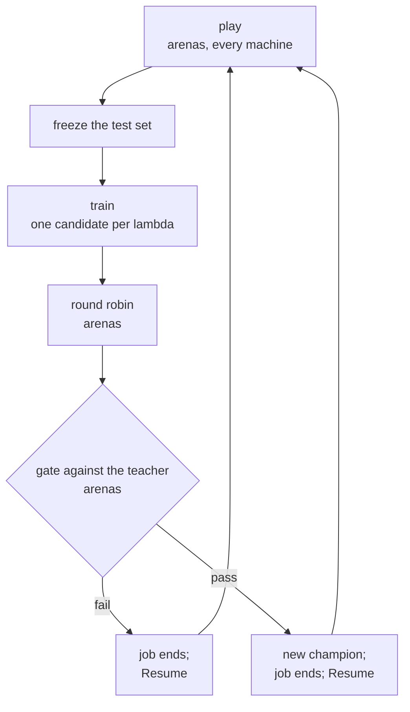

# Developing Temper

For what Temper is and how to run it, see [README.md](README.md).

Temper is developed on Windows only, from **Git Bash** (it comes with Git for Windows), never
PowerShell or cmd. Development also requires **Google Drive for desktop**, with My Drive on `G:`:
what the machines share, such as Lc0's converted games, lives in `G:/My Drive/kalo-games`, and the scripts
and binaries read and write it there.

## The workspace

The repository holds the engine, an arena that plays engines against each other, and a trainer for
their networks. Three binaries, each with its own crate:

- `temper-chess`, the engine.
- `arena`, which plays games: matches, and, as one of the smithy's arenas, every game of a forge or
  a tune.
- `smithy`, which makes the sources' corpora and trains networks (the smithy, dealing its jobs to
  the arenas), inspects checkpoints and installs players. Training needs an NVIDIA GPU.

And one library, `pgn-replay`, which reads PGN moves for `arena` and `smithy`.

Run every binary through its script in `bin/`, which builds it when needed and runs it from the
repository root:

```bash
./bin/temper-chess
```

## One generation

`configs/chess/` holds two kinds of config. A **source** makes one corpus, once, on Drive, for every forge
named after it:

- `lc0.yaml`: Lc0's training tars, converted by its Convert job (`data/chess/lc0/`), up to its cap.
- `pesto.yaml`: the PeSTO evaluation's self-play at depth 9, played by its Play job (`data/chess/pesto/`), to
  its `training_positions`; it also holds `pesto`'s `tune:`.

Each also sizes its frozen test set, `test_positions`. A **forge**, `<source>-<architecture>`
(`lc0-psq`, `pesto-psq`), is a network trained by one job of the smithy, on the GPU machine: one
file holding its sizes from generation 2 on and its gate (`grid_center`, `training_positions`,
`test_positions`, `round_robin_pairs`, `gate_elo_d`), its generations' `tune:`
(below) and its network's `labels:` (its source), `architecture:` and `training:`. Every job starts
from the smithy's page, and every game is played by the arenas, `arena start`, one on every machine,
over HTTP on the local network.

A config can be forged more than once: each time is a **run**, numbered from 1, in
`data/chess/networks/<config>/run-<n>/` with its own copy of the config as it started, `config.yaml`, so
editing `configs/chess/` changes only new runs. Every phase resumes from the run's files. Run n is
named `<config>-r<n>`, the first included (`pesto-psq-r1`, `pesto-psq-r2`). A network is named by
its config, then each part marked by a letter, the run always and last:

- a generation's winner, `<config>-g<g>-r<n>`: `pesto-psq-g1-r1`;
- one lambda's candidate, `<config>-g<g>-l<lambda>-r<n>`, the lambda with two decimals:
  `pesto-psq-g1-l0.95-r1`.

A generation has at most one winner, so the winner's name leaves its lambda out; the page shows it
beside it. A player is a network with what it searches with,
always written after an `@`: `@default`, the untuned defaults; `@t1`, its tune; or `@<cp>`, a margin
per ply (`pesto-psq-g1-r1@t1`, `pesto@default`). Only a generation's winner is tuned.

**Generation 1** trains on its source's whole corpus, judged on the source's whole frozen test set,
with no play phase, and refuses to start until the corpus is complete; the run records the sizes in
its `corpus.txt`. Its winner is gated against the PeSTO evaluation once: a fail ends the run, since
it says the network is wrong; a pass makes it generation 2's teacher.

From **generation 2** on, each generation has a **teacher**, the last champion, and runs unattended:

1. **Play.** The arenas play the teacher against itself, searching each position at depth 9: the
   test games first, then the training games, the training set (`training_positions`, 1024 x 1024 x
   1024 in every config).
2. **Test set.** The smithy draws the fixed test set every lambda is judged on from the test games,
   once, and keeps it on disk.
3. **Training.** The smithy trains 9 candidates at once, one per lambda, around the last winner's.
   Each label blends a position's search score with the game's result, weighted by lambda.
4. **Round robin.** The arenas play the candidates against each other; the best is the winner.
5. **Gate.** The arenas play the winner against the teacher, an SPRT. A pass makes it the new
   champion and the next generation's teacher, which starts when the developer presses the run's
   Resume; a fail ends the run (its phase `stopped`), and a new run starts over.

A transformer, which the engine cannot play yet, ends at its training.

The smithy runs at most two jobs at once: Lc0's Convert, which uses neither the arenas nor the GPU,
beside one arena job (a forge, a tune, or PeSTO's Play). Each has its own Stop; Convert's abandons
the tar in flight, redone next time.



## Setting up a machine

Once, on every machine.

Build tools and Rust, then a new terminal:

```bash
winget install --id Microsoft.VisualStudio.2022.BuildTools --override "--passive --wait --add Microsoft.VisualStudio.Workload.VCTools --includeRecommended"
```

```bash
winget install --id Rustlang.Rustup
```

For full speed, exclude the repository, `%USERPROFILE%\.cargo` and
`%USERPROFILE%\.rustup` from Microsoft Defender, and set Windows' power mode to Best performance.

A name for the machine, lowercase letters and digits, different on every machine:

```bash
echo 'name: <name>' > data/machine.yaml
```

The external engines it may play, Stockfish first; then set each `path` in the copy:

```bash
cp examples/engines.yaml data/chess/engines.yaml
```

The opening positions and the Syzygy tablebases (about 150 GB), into the repository's `data/`:

```bash
./bin/uho-book.sh
```

```bash
./bin/syzygy.sh
```

Google Drive for desktop, in streaming mode with My Drive on `G:`, on every machine, the arenas'
included: Drive is Temper's store, `G:/My Drive/kalo-games`, the same tree as the repository's `data/`. A file
is made on the local disk and reaches Drive only whole, never written or appended there in place:

- a run's networks (every candidate, every teacher) as soon as they are complete; the arenas read
  them from Drive by their path there, waiting for one not yet visible on their machine, and giving
  its chore back after 30 minutes;
- a run's living files (its state, logs, records) as whole copies at every phase boundary, so a dead
  local disk loses at most one phase;
- a closed generation's directory, moved whole, its local copy deleted;
- a tune's files every 15 minutes, then the whole tune beside its network at its end;
- the sources' corpora, segment by segment.

Every reader (`arena duel`, an install, the page's View) looks on the local disk
first, then on Drive. Folders may be made available offline in Drive's settings to read them faster.

A Python environment named `.kalo-games` with PyTorch, for `smithy`: on the GPU machine to train, and
on any other machine that runs `smithy` or its tests:

```bash
winget install --id astral-sh.uv
```

```bash
uv venv .kalo-games --python 3.14
```

```bash
source .kalo-games/Scripts/activate
```

```bash
uv pip install "torch==2.11.0" numpy --torch-backend=auto
```

On a machine without an NVIDIA GPU (to run `smithy`'s tests), name the CPU
backend instead of `auto`:

```bash
uv pip install "torch==2.11.0" numpy --torch-backend=cpu
```

`auto` picks the build from the graphics hardware it finds, and on any Intel GPU, however old,
it installs the XPU build (`2.11.0+xpu`). Python imports it, but `smithy` links `c10.dll` directly,
and on an Intel GPU the XPU build does not support, that DLL fails to load: every `smithy` binary,
tests included, dies on `c10.dll` though the file is there (2026-10-15).
`python -c "import torch; print(torch.__version__)"` must end in `+cu...` on the GPU machine and in
`+cpu` everywhere else.

Activate it before every `./bin/smithy`. Its GPU commands print `device = Cuda(0)` first: if they
don't, it is training on the CPU.

## Jobs: the smithy and the arenas

The smithy (`smithy`) runs one job at a time, a forge or a tune, and deals it as chores to
the arenas (`arena`), at most one on every machine, each chore a number of tasks: a game, or a pair
of games on one opening. A smithy runs on any machine: a full run trains only where a CUDA GPU is,
and the page greys it out elsewhere, saying so; a scaled run (below) trains on the CPU. Several
smithies may run at once, each arena playing for the one whose claim it holds.
`data/machines.yaml` on Google Drive lists every machine, highest rank first: a smithy claims the
arena of each, and between two jobs of the same kind (full or scaled) the higher-ranked smithy keeps
the arenas. Written once, on Drive, so every machine reads the same copy.
Its shape is `examples/machines.yaml`'s:

```bash
cp examples/machines.yaml "/g/My Drive/kalo-games/data/machines.yaml"
```

Then the names in that copy edited. A local `data/machines.yaml` is no longer read; the older
`smithy:` and `arenas:` are refused, the smithy saying the form to write.

The smithy, in its own terminal, left running: it starts with no job, and claims every listed
machine's arena that answers, unclaimed, whatever its commit: the Machines table says when an arena's
commit differs from the smithy's, for the developer to judge. A machine that fails (off, no arena,
held by another smithy) is tried again after 10 s, then after waits doubling
up to 5 minutes while it keeps failing the same way; the page's Machines table says why, and when the
next try is.

```bash
./bin/smithy start
```

Jobs are started and stopped from its page, opened in a browser on that same machine,
`http://127.0.0.1:47821/`. The page lists every forge config with every run of it: View shows any
generation of a run, never resuming it; Resume continues a run that has not ended; New
run starts the config afresh. Under a run, each generation whose winner passed its gate can be
tuned (below), by hand, whether the run has ended or waits; `pesto` always can. One job at a time; when it ends, its result stays
on the page until the next one starts, without restarting the smithy. The page opened from another
machine shows the same, read-only.

On every machine that should play, an arena, started by hand in its own terminal, left running: it
idles until a smithy claims it, then plays for that smithy alone. A smithy claims arenas only while
its job deals games (a forge's play, round robin and gate, a tune, a test, PeSTO's play) and
releases them after 60 s dealing none, so another smithy's job plays meanwhile; Install claims the
arena it installs on. When two smithies want one arena, a full job's claim takes it from a scaled
job's, and between jobs of the same kind the smithy ranked higher in `machines.yaml` takes it; a
job left with no arena says it waits, and the Machines table names each holder by its rank. A smithy polls its arenas every
10 s: one unanswering for 30 s is late, for 60 s lost, its chore dealt again. An arena unpolled for
60 s releases itself and idles, claimable again; tasks it finished meanwhile wait in memory and go
to the same smithy when it claims the arena back. A restarted smithy claims its arenas back at once.
Closing an arena withdraws its machine.

```bash
./bin/arena start
```

From another terminal on the same machine, what each is doing, or a stop (the smithy's stops its
job at its next safe point, then itself; the arena's at once, its chore handed out again):

```bash
./bin/smithy status
```

```bash
./bin/arena status
```

```bash
./bin/smithy stop
```

```bash
./bin/arena stop
```

Any browser on the local network shows the job as it goes, read-only, at the smithy machine's
address on that port, `http://<machine>:47821/` (`smithy status` prints it). Only `smithy stop` or Ctrl+C ends the smithy.

The smithy listens on TCP port 47821, an arena on 47823, each on `127.0.0.1` and on its machine's
LAN address. Every machine's firewall must allow both, once, below. An arena listens on its
machine's LAN address as it was at `arena start`: after the machine changes network, stop and start
it again.

A stopped run resumes where it stopped with its Resume, on this smithy or any other: several
smithies may run at once, on any machines, but a job runs in one only. A forge run, a tune, PeSTO's
play, Lc0's Convert and the first freeze of a source's test set each hold a lease, in the memory of
the smithy running the job. Starting one asks every other machine's smithy over the LAN (port
47821), once, and waits for nothing: the job is refused while another smithy runs it, for 2 minutes
after another stopped it (Drive syncing its last files), or when another smithy's build is too old
to ask. A machine that does not answer is taken as off. To move a job, stop it where it runs, then
resume it on the other machine. The `lease.txt` files older builds left on Drive are ignored and may
be deleted. A forge run's open generation and state
are copied to Drive when it stops and every 30 minutes of training, and a Resume elsewhere copies
them down. Full runs train only where CUDA is: on a machine without it, the page says so and offers
scaled runs alone.

An NNUE forge trains on its training set fully shuffled: its training first scatters the training set into
`data/chess/buckets/` on the smithy's local disk: once per source for generation 1 (about 15 GB for Lc0's,
shared by every `lc0-` forge; PeSTO's likewise), and about 15 GB per self-play generation after. A disposable cache: deleting it costs only a new scatter. Each lambda keeps one checkpoint, its best
so far (the others are deleted after every round).

## Scaled runs

For development, on any machine, a GPU or not: a run started with the page's New scaled run, at a fixed
factor s of 1024 (`scale::DEFAULT`), every phase in minutes, nothing about strength.
Data volumes and the work of a round divide by s, game counts by its square root, the search's
depth loses log2(s) / 2 plies, each down to a floor that keeps its phase meaningful; the run's shape
(lambdas, stages, patience, the gate's rules) stays the config's. The scale is frozen into the run's
own `config.yaml` (`scale: <s>`) and marked on the page wherever the run is named.

A scaled run is a run like any other, numbered with the full ones and saved to Drive as they are. On a
source, it reads a 1/s share of the corpus, its first training files, scattered into buckets of
their own (`data/chess/buckets/lc0-s1024`), and a fixed subset of the source's frozen test set: sources
are never scaled. Its networks play in their run alone: never installed nor a side of a test, and tuned only
by a tune scaled as their run, to debug the tune itself.

## Matches

```bash
./bin/arena duel pesto@default pesto-psq-g1-r1@t1 --time 10+0.1
```

- `match <a> <b> <n>`: n games.
- `sprt <a> <b> <elo>`: whether b is at least that many Elo stronger.
- `duel <a> <b>`: until one is shown stronger, or 1000 games.

Each needs `--depth <d>` or `--time <base+inc>`. A player is a Temper player, `pesto` or a forge run's
network (`pesto-psq-g1-r1`, `pesto-psq-g1-a2-l0.95-r1`), always followed by `@default`, `@t1` or
`@<cp>`; or `stockfish-<level>` (0 to 20), `stockfish-elo-<rating>`, or another engine of
`data/chess/engines.yaml`, with no suffix. Against an external engine, Temper plays over UCI what it has by
itself, so its suffix must say it: a tuned network `@t1`, an untuned one or pesto `@default`.

## Tuning search parameters

A tune of a network's search parameters by SPSA is the smithy's other job, its pairs played by the
same arenas, started from the smithy's page: the winner of a generation that passed its gate in an
ended forge run (`pesto-psq-g1-r1`), or `pesto`. The config's `tune:` says how long and at what
control, the run's frozen copy for a network, `configs/chess/pesto.yaml` for `pesto`:

```yaml
tune:
  length: default          # 16,384 pairs; or a number of pairs, at least 100
  control: 10+0.1          # or {depth: d}
```

Every tune starts from the default parameters, whatever the player, so a run's generations may be
tuned in any order.

Under a clock the smithy benches its own machine at the start, and every arena scales its clock to
its speed against that one. The result goes to the network's `parameters.txt`. A forge run's
network is tuned in its generation's folder, `run-<n>/gen-<g>/tune/`.

**One tune a network:** an unfinished one resumes when started again; a new tune of a network whose
tune is finished is refused, since retuning is not supported yet. To tune it again, move or delete
its tune folder by hand.

### The firewall

The smithy listens on TCP port 47821 and an arena on 47823, which every machine's firewall must
allow, since any machine may run either, and only on a network marked Private in Windows' settings:
a Public network leaves the ports closed. When Windows asks, at
the first start, choose Cancel: its own rule would open every port on Public networks. Instead,
once on every machine, from a Git Bash run as administrator:

```bash
netsh advfirewall firewall delete rule name="smithy"
```

```bash
netsh advfirewall firewall delete rule name="arena"
```

```bash
netsh advfirewall firewall add rule name="kalo-games smithy" dir=in action=allow protocol=TCP localport=47821 profile=private program="C:\dev\kalo-games\target\release\smithy.exe"
```

```bash
netsh advfirewall firewall add rule name="kalo-games arena" dir=in action=allow protocol=TCP localport=47823 profile=private program="C:\dev\kalo-games\target\release\arena.exe"
```

The first two remove Windows' own rules, if any were made. To check, each rule should show Profiles
Private, TCP and its LocalPort, and `name="smithy"` and `name="arena"` should match no rule:

```bash
netsh advfirewall firewall show rule name="kalo-games smithy" verbose
```

```bash
netsh advfirewall firewall show rule name="kalo-games arena" verbose
```

```bash
netsh advfirewall firewall show rule name="smithy"
```

```bash
netsh advfirewall firewall show rule name="arena"
```

Before starting the smithy, the current profile should be the Private one:

```bash
netsh advfirewall show currentprofile
```
