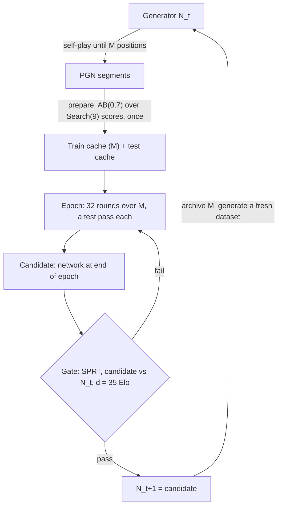

# Generational self-play training

**Superseded, see one-learning-rate.md, lockstep-lambdas.md and round-robin-selection.md.** The generational loop survives; its learning-rate grid, `rotor-prepare` caches, fixed-size datasets with per-epoch retries and test-loss challenger choice were replaced. Its SPRT lives on in sprt.md.

## Status

Prerequisites 6 and 8 have since been built (rotor-train-dataset-cache.md): `rotor-prepare` writes
the dataset's train and test caches with the block-of-33 split, and `rotor-train train` reads the
train cache cyclically through a shuffle buffer. The streaming self-play pipeline that briefly
stood in for them was deleted. Everything else below is still design.

Design settled with the developer, not implemented, with four design points still open (see
"Undecided design points") and blocked besides on the prerequisites listed below. The first
concrete step is one hand-crafted dataset, read two ways: the convergence check on epoch 1, and the
prefix sweep that measures `M`. Neither waits on a settled learning rate, because the loop carries
the whole grid as a population and both experiments run it.

Settled 2026-09-25, in one session. Two refinements to the original design: a dataset is a fixed
number of positions `M` rather than a fixed number of games, and a failed gate re-iterates that
same dataset for another epoch instead of consuming freshly generated games. Then two replacements:
the gate becomes an SPRT with a score-linear LLR in place of AlphaGo Zero's 400 games at 55%, and
the learning rate becomes a Population Based Training grid in place of a single chosen value. All
four are folded into the text below.

The consequences reach further than the four changes themselves: the loop is built on
`rotor-train`'s corpus-cache path rather than its streaming one, with a `prepare` step per dataset
writing a train and a test cache; self-play idles during a generation; the train cache is read
through a shuffle buffer; the challenger is chosen by test loss across arms rather than being the
end-of-epoch network; and `M` becomes the design's most important number, since a generation must
now find its 35 Elo inside one dataset.

## Idea

Replace training on one fixed dataset with a loop in which the network that generates the training
games is itself the latest accepted product of training. The dataset is still fixed and still
trained for as many epochs as it takes, but it is replaced by a freshly generated one every time
the generator is promoted:



This is expert iteration, with AlphaGo Zero's structure: the optimizer trains continuously, and a
gate decides only which network is trusted to generate games. The network is never asked to
converge to the hand-crafted evaluator. It only has to keep beating its own generator.

## Why it should improve

- **Search amplification.** Labels come from Search(9) over N_t, which is stronger than N_t's
  static evaluation. Training distills that search into N_{t+1}'s static evaluation, and
  Search(9) over N_{t+1} then reaches further than Search(9) over N_t.
- **Grounding by the game result.** Search alone cannot correct errors that N_t and its own search
  share, where a misjudgement only pays off beyond the horizon -- and each generation's fitting
  error would otherwise become part of the next generation's target. Only the game result
  (through lambda) and mate/tablebase labels bring in information from outside N_t.
- **Grounding travels backward one generation at a time.** With `L_t = 0.7 * L_{t+1} + 0.3 *
  score_t`, the result's weight `k` plies before the end is `0.7^k`: about 0.17 at 5 plies, 0.03
  at 10, effectively zero at 30. Within one generation the result directly grounds only the last
  few plies. The next generation's depth-9 searches from earlier positions reach leaves scored by
  those improved values, pushing the grounding back another ~9 plies. Opening and early
  middlegame blind spots are therefore fixed last, over several promoted generations: expect
  slow, steady per-generation gains, not a jump.

  ```mermaid
  flowchart RL
      R["Game result"] -->|"lambda: last few plies"| E["Endgame values, N_t+1"]
      E -->|"Search(9) leaves, next generation"| LM["Late middlegame values, N_t+2"]
      LM -->|"Search(9) leaves, next generation"| O["Early middlegame and opening, N_t+3 and later"]
  ```

This deliberately brings back the moving teacher that eval-tuning.md avoided (it chose a fixed
teacher so that labels are computable once, offline). The difference is that here the teacher
moves only at promotions, not at every step, so each dataset is still labelled offline, once, by a
fixed network, and re-read unchanged by every epoch of its generation.

## Terms

- **Batch**: positions per optimizer step (`training_batch_size`).
- **Dataset**: one generator's self-play games, preprocessed once into a train cache of `M`
  positions and a test cache beside it. Labelled once, fixed for the whole generation, archived
  when the generation ends.
- **Round**: `steps_per_round` optimizer steps, followed by a full test pass over the test cache.
  The unit of measurement, as on the existing corpus-cache path (`round.rs`'s `run_round`).
  No checkpoint is selected from a round.
- **Epoch**: `rounds_per_epoch` rounds, and one `rotor-train train` invocation. Meant to be one pass
  over the train cache's `M` positions, which it is exactly when the dataset is built as designed --
  but **declared** in `net.yaml` rather than derived from the cache's row count, so that how much
  optimizer progress buys one gate attempt stays fixed across datasets instead of drifting with
  whatever each one came out at. `run_train_nnue` prints the ratio of the two, so a dataset that is
  not `M` positions shows up rather than hiding in the arithmetic. Otherwise the ordinary meaning of
  the word: within a generation the second and later epochs re-read the same positions with the same
  labels, in a different order.
- **Generation**: everything trained while one network is the generator: one dataset and
  `(failed gates + 1)` epochs over it. Variable, not chosen.

## Decisions

- **A population of learning-rate arms, not one run.** `rotor-train` trains every rate in the grid
  at once over the same dataset. Training never restarts from scratch: the promoted checkpoint
  carries forward, so every position's effect survives in the weights. Forgetting is not expected
  to be a problem either, since every game starts from a random position of the 2.6M-position UHO
  book plus 6 randomized plies, so the training distribution stays broad and fairly stable across
  generations.
- **This is Population Based Training with a fixed grid.** On a promotion, every arm resets to the
  promoted checkpoint's weights, with a fresh optimizer warmed up over 1000 steps, and continues at
  its own learning rate (weights only since 2026-09-25, see rotor-train-generations.md for why the
  optimizer state is not carried). PBT's "exploit" step is that copy; its "explore" step is the grid itself rather than a mutation of the
  winner's rate. The simplification costs one thing worth watching: **a fixed grid cannot discover a
  rate outside itself.** If the winning arm sits at an edge of the grid for several generations
  running, the grid is mis-centred and should be shifted, exactly as a grid search whose optimum
  lands on an edge has found the edge rather than the optimum.
- **The grid is meant to retire.** It is the learning-rate search folded into the loop rather than
  run beside it, so once one interior rate wins for several consecutive generations the grid
  collapses to that single rate and the population becomes one arm again. `learning_rate` accepts a
  scalar as a one-element list, so that endgame needs no code change.
- **Arms train in lockstep over one shared batch stream**, not one after another. They read the
  same rows in the same order from one decode of the cache, so the CPU pipeline is paid once rather
  than once per arm, and the arms differ in nothing but the learning rate. Starting from a common
  checkpoint, that makes the comparison between them exact rather than merely fair.
- **A dataset is `M` positions, not a game count.** Self-play runs until the dataset holds `M`
  positions; how many games that takes depends on the average game length and is a self-play
  scheduling fact, not a training parameter. Counting positions rather than games makes the epoch
  exact, and it makes the dataset a finite, complete artifact rather than an open-ended stream --
  the property the preprocessing step below depends on. Whole games only: self-play accumulates
  complete games until the count reaches `M` and the overshoot is trimmed, never cutting mid-game.
- **A dataset is `33 * 1024 * 512 = 17_301_504` positions, which is `M = 2^24 = 16_777_216` train
  rows and `2^19 = 524_288` test rows.** The two constraints meet exactly here: the block-of-33 split
  needs a multiple of 33, and the epoch wants a power of two so that `M / (batch * steps_per_round)`
  is whole -- 32 rounds at batch 1024 and `steps_per_round: 512`, with nothing left over. `M` is the
  *train* half; self-play counts total positions.

  At the measured 106.5 plies per game (see "Values awaiting measurement") that is about **163k
  games**. This is still a starting value for `M`, not a measured one; see "Choosing M" for what
  sets it and how to measure it.
- **`M` cannot be small, because a failed gate brings no new information.** A generation has to
  find 35 Elo inside one dataset, and it then iterates that dataset until it does. Two ways to see
  why the number has to be in the tens of millions:

  | train volume | games at 106.5 plies | positions/param | games/param |
  |---|---|---|---|
  | 2M | ~19k | 6.8 | 0.06 |
  | 10M | ~94k | 34 | 0.31 |
  | 16.8M (chosen) | ~158k | 56 | 0.53 |

  Positions within a game are near-duplicates, so the independent unit is closer to the game than
  to the position: against amanda's roughly 0.3M parameters, even the chosen `M` supplies fewer
  independent games than there are weights. Below about 10M the dataset is small enough that
  unbounded re-iteration memorises it, and the gate -- correctly -- stops passing. For scale, this
  is still tiny by the field's standards: Stockfish trains on billions of positions and Leela's
  sliding window is hundreds of thousands of games. It is the single-PC budget, not the
  statistics, that sets the ceiling.
- **The train cache is read through a shuffle buffer.** Re-iteration makes read order matter in a
  way single-pass streaming never did. A cursor that wraps back to row 0 replays the same batches
  in the same order in every epoch of a generation (exactly so at `M = 2^24` with batch 1024, which
  divides into 16384 whole batches), and a batch of 1024 consecutive rows is about 13 consecutive
  games, whose AB(lambda) labels are related by the lambda recursion itself. A buffer of `B`
  individual positions, emitting a random one and refilling from the stream, fixes both. The unit
  is the position, not the game: plies of one game land in different batches, which is the whole
  point. `B = 2^21` spans about 20k games at 106.5 plies, so a batch of 1024 draws from far more games
  than it has slots; see "Training parameters" for how the size is chosen.

  - **Nothing shuffles at build time.** A permutation written into the file is the same permutation
    in every epoch, so it produces identical batches pass after pass and cannot replace the buffer;
    and once the buffer exists, it adds nothing. The buffer's sliding window would in principle
    leave global order unmixed, but there is no meaningful global order here to mix: every game
    starts from a random UHO opening plus 6 randomized plies under one generator, so the games are
    exchangeable and "early in the file" carries no information. The dataset build stays as it is,
    writing each game's plies contiguously, which is also what lets zstd compress the cache:
    positions are sparse piece lists and consecutive plies differ by one move.
  - **The buffer never drains.** A streaming shuffle normally degrades at the end of a pass, as the
    buffer empties and the last records emerge nearly in order. Here reading is cyclic and
    re-iteration unbounded, so the buffer keeps refilling across the wrap and every part of every
    epoch is equally shuffled. One RNG stream for the whole run, no per-epoch reseeding.
  - **The epoch boundary counts rows read, not rows emitted.** Because the buffer straddles the
    wrap, a few rows read during epoch k are stepped on during epoch k+1. The cursor still advances
    exactly `M` rows per epoch, so the gate trigger stays exact; only the emission order drifts.
  - **The test cache is not shuffled.** `run_test_pass` sweeps it in order from row 0 every time,
    which is what makes the loss comparable from round to round.

  Permuting read order directly is not an option: `reader.rs` reads a zstd-compressed stream of
  variable-length records, so there is no byte offset for row `i` and `seek_to` reaches one by
  reopening the file and discarding records. A permutation would be quadratic over an epoch. The
  buffer is sequential-only, so it reads the cache exactly as written. This is how Stockfish and
  Leela do it.

  The cost is the property `training.md` bought with "no RNG, no seed, just this one advancing
  integer": a resumed run no longer reproduces the original exactly, because the persisted cursor
  does not capture the buffer's contents. Record the seed and accept that a resume draws a
  different order, rather than serialising the buffer.
- **The challenger is the lowest-test-loss checkpoint across every round of every arm** since the
  generation began, i.e. since the last reset. All the arms of one generation share one dataset,
  one set of targets and one test cache, so their losses are directly comparable; across
  generations they still are not.

  Two things follow. The *across rounds* half will usually be a no-op: test loss falls almost
  monotonically, and the per-position split makes that more so, since memorisation keeps pushing it
  down, so the argmin will nearly always be the latest round. The real work is done *across arms*.

  And test loss is here only nominating the contestant, not deciding the outcome: the gate still
  has to pass it. A contaminated metric choosing who plays is a far weaker dependency than one
  choosing who wins.
- **Superseded 2026-09-25: the gate plays exactly one challenger**, the argmin, decided with the
  developer; see "How many arms are nominated to the gate" under Open. The original reasoning:
  **The gate runs on the best two or three arms, not only the argmin**, in loss order, stopping at
  the first that passes. Under refinement 2 a stall is permanent, so a generation that fails
  because the loss nominated a memorised arm while another would have passed is a real loss, and
  gates cost minutes on machines that are idle anyway. This buys away the dependency on the loss
  being right.
- **Gate: an SPRT at `d = 35` Elo, `alpha = beta = 5%`, against N_t** (see below). On a pass, the
  candidate becomes the generator, its dataset is archived and a fresh one is generated. On a
  failure, the same dataset is trained for another epoch; the candidate is not discarded, only not
  yet trusted to generate games.
- **A failed gate re-iterates the dataset; it does not ask for new games.** Self-play is orders of
  magnitude more expensive than a training pass, and games produced by a generator that has just
  been beaten would be wasted. Re-iterating is nearly free (minutes of GPU per epoch), so the loop
  keeps squeezing the dataset it already has.
- **The gate cannot be fooled by re-iteration.** It is played at fixed depth from book openings,
  not scored on the training data, so a candidate that has merely memorised the dataset fails it.
  Overfitting shows up as failed gates, never as false promotions. This is what makes unbounded
  re-iteration safe.
- **No cap on epochs per generation.** The loop re-iterates until the candidate beats its
  generator. A generation that never passes is not a case for the loop to handle automatically: it
  is a result, saying that this architecture on this data cannot find another 35 Elo, and the
  developer changes something. See "Risks accepted" for how to tell that apart from `M` merely
  being too small.
- **Self-play is idle during a generation.** Once the dataset is complete, the CPU machines stop
  and wait for a promotion. No games are ever generated by a generator that turns out to be
  beaten, at the cost of idle CPU while the candidate trains and plays its gates. This replaces
  the earlier overlapped schedule, which only made sense when a failed gate consumed fresh games.
- **The gate is triggered by a full pass over the train cache, not by a round boundary.** Rounds
  are the test cadence and there are 32 of them per epoch; the gate fires on the 32nd, when
  the stream's cursor wraps back to row 0. `reader::CacheFile` already reads cyclically and
  `TrainStream::rows_per_epoch` already reports how long one pass is, so re-iteration needs no new
  reading mechanism -- only the condition on top of them.
- **The loop is built on the corpus-cache path, not the streaming one.** `rotor-train` had two
  read sides: a cache built ahead of time by `prepare`, and a streaming path with an incremental
  split. This design uses the first, and the second has since been deleted
  (rotor-train-dataset-cache.md). Refinement 1 is why it can: a dataset of `M`
  positions is a finite, complete artifact before its generation's training starts, so it can be
  preprocessed in one pass with the row counts known up front, which is exactly what the corpus
  path already assumes. Every constraint the earlier drafts fought -- the mod-33 phase split, the
  multiple-of-32 round volume, the multiple-of-33 `M` -- belonged to the streaming path and does
  not apply here.
- **A preprocessing step per dataset, writing two files.** Built: `dataset_cache.rs`, run by
  `rotor-prepare`, does a row-count pre-pass and then writes the two caches in one replay. Per
  generation: self-play writes PGN segments, `prepare` turns them into the two caches, and `train`
  reads them for as many epochs as the gate needs.
- **The split is per position, stratified in blocks of 33.** `prepare` replays the games and, in
  each block of 33 consecutive positions, picks one at random for the test cache and appends the
  other 32 to the train cache. Decided once at preprocessing time and fixed for the life of the
  dataset, so every epoch of a generation trains on the same rows and is measured on the same rows.

  - **The ratio is exactly 32:1** over every complete block, with no fixed phase: a deterministic
    stride would have none either, since game length varies, but the random offset removes the
    question entirely.
  - **The block counter runs continuously across game boundaries.** Resetting it per game would
    leave each game a remainder (106 plies is three blocks plus 7) and break the ratio.
  - **The trailing partial block of the dataset goes to the train cache.**
  - **The draw is a deterministic function of the block index under a fixed seed**, not a process
    RNG, matching `builder.rs`'s own `TRAIN_TEST_SPLIT_SEED` convention: a rerun of `prepare` over
    the same dataset must reproduce the same split rather than reshuffle it.
  - **The pre-pass does not have to reproduce the draws.** The build counts rows before
    writing either header, and `is_train_game` is deterministic precisely so the counting pass and
    the writing pass agree on where every row goes. Under the block scheme every complete block
    yields 1 test row and 32 train rows whatever the draw is, so both counts follow from the total
    position count alone and the two passes cannot disagree.
  - **Stratification beats i.i.d. sampling** at the same rate, which would clump and leave
    stretches of the stream unsampled.

  `builder.rs` splits the curated path per *game* instead, but its own reason does not carry over:
  it notes that today's position-indexed format "could support a finer-grained split just as
  easily" and chose per-game only to stay compatible with a storage format this project is not
  adopting.
- **A test pass at the end of every round, not once per epoch.** `run_round` already does this:
  `steps_per_round` steps, then one full no-grad pass over the test cache. At batch 1024 and
  `steps_per_round: 512` that is 32 test passes per epoch, giving a curve dense enough to read
  within a generation rather than one point per gate attempt.
- **Test loss within a generation shows fitting, not generalisation.** The epochs of one generation
  share one dataset, one set of targets and one test cache, so the curve is comparable across them
  in a way it never is across generations. But with a per-position split, a test position's own
  neighbours are in the train cache, and `L_40 = 0.7 * L_41 + 0.3 * score_40` relates their labels
  by definition, so the curve keeps falling under memorisation rather than turning up. Read it as
  a smoke test that the optimizer is still reducing loss on rows it does not step on, not as
  evidence that the dataset still has something to give. The gate remains the only honest
  out-of-sample measurement. Splitting per game instead is the fix if the curve is ever needed for
  more than that.
- **A generator is identified by the epoch that produced it.** Every generator is the network at
  the end of some epoch k that passed its gate, so the epoch number names it uniquely, with no
  separate generation counter; `hand-crafted` is the generator before any training. Self-play
  games record their generator in their PGN headers (e.g. `[White "rotor amanda epoch 5"]`), so
  provenance survives independently of file paths, and a generator's whole dataset lives in one
  directory (e.g. `data/self/amanda/epoch-0005/{stem}-{timestamp}.pgn.zst`), archived in place when
  the generation ends. This is the generator's epoch, not any of the epochs that train on the
  dataset; several consuming epochs share one dataset when gates fail.
- **The root of the lineage is always `hand-crafted`**: what the first generation trains on,
  never edited at promotions. It was `preprocessing.parent` in `net.yaml`, a field that only ever held
  that value; since 2026-09-25 it is the constant `generation::LINEAGE_ROOT` and NNUE configs have no
  `preprocessing` section (rotor-train-generations.md). Which generator is current is the loop's
  state, not the config's: it is the network's highest generation directory.
- **No early stopping in the loop.** `EarlyStopping`'s patience counter would have to run across
  generations, where test losses are measured against different targets and are not comparable, so
  it has nothing meaningful to count and must not end the run. Within a generation the 32 losses
  per epoch do compare, but a flattening curve there is a diagnosis to read, not a stop condition:
  only the gate ends a generation, and only the developer ends the loop.
- **Retention by test loss does not apply across generations**, for the same reason. What is worth
  keeping is every generator (N_0, N_1, ...) and every gated candidate, not the checkpoints with the
  lowest test loss (rotor-train-checkpoint-retention.md's `BEST_CHECKPOINTS_KEPT`).
- **lambda = 0.7 in every generation.** Never 0: the game result is the loop's main anchor to the
  truth.
- **Training parameters.** All starting points, chosen against `M = 2^24`:

  | Parameter | Value | Consequence |
  |---|---|---|
  | `training_batch_size` | `1024` | 16384 optimizer steps per epoch |
  | `steps_per_round` | `512` | `2^19` positions per round, one test pass each |
  | `rounds_per_epoch` | `32` | `2^24` positions per epoch, exactly one pass over `M` |
  | `shuffle_buffer` `B` | `2^21` | about 20k games in the window, about 200 MB |

  All four are `net.yaml` fields. The test set's size is not: the split is exactly 32 train rows per
  test row, hard-coded as `dataset_cache::SPLIT_BLOCK = 33`, so a dataset of `M` train rows carries
  `M / 32` test rows and one round's test pass is `1/32` of its train volume. That 33 is inherited
  from the retired streaming path's ratio rather than chosen; see "Values awaiting measurement".

  - **Batch 1024**, down from amanda's 4096. Positions are scarce and compute is cheap, but the
    sharper reason is the gate: it costs hours and fires once per epoch, so an epoch should
    represent a substantial amount of learning. At 4096 an epoch is 4096 steps; at 1024 it is
    16384, so each gate attempt is bought with four times the optimizer progress. Not lower:
    `reader.rs` warns that small batches make `to_dense_batch`'s CPU-side assembly the bottleneck
    rather than the GPU, and at 0.3M parameters the GPU is already underused.
  - **The learning rate is a grid the loop carries, not a number chosen up front.** It cannot be
    inherited, since amanda's was set against batch 4096, and rescaling rules (halve for sqrt,
    quarter for linear) only say where to look. Rather than settle it in a separate experiment and
    commit, the loop trains all six rates as a population and lets the gate pick; see
    "The learning-rate population". The grid retires once one interior rate keeps winning.
  - **512 steps per eval.** Dense enough to read a curve inside one epoch and still see its shape
    across a re-iterated generation. The round count is the last thing to cut if the test passes
    turn out expensive, since the curve is what they buy: pin the test set in memory first (it is
    fixed and swept identically 32 times per epoch, so it can be decoded once per run rather than
    once per round), and raise the block size second.
  - **`B = 2^21`.** The criterion is how often two positions in a batch share a game: at 106.5 plies
    each, a position in a batch of 1024 has roughly `105.5 * 1023 / B` expected same-game
    partners, so about 42% of positions are affected at `B = 256k`, 10% at `1M`, 5.1% at `2^21`
    and 2.6% at `2^22`. `2^21` is also an eighth of `M`. At roughly 100 bytes per resident record
    (a `CacheRecord` holds a heap-allocated piece list) it costs about 200 MB; go to `2^22` if the
    RAM is free. `training.shuffle_buffer` in `net.yaml` is where it is set.
- **The loop is strictly sequential.** Generate the dataset, then train and gate against it until a
  promotion, then generate the next one. Self-play dominates the cost completely: an epoch is
  minutes and a gate is minutes, against two days per dataset, so even a generation that runs to
  thirty failed gates spends under four hours on training and gating combined.

  ```mermaid
  sequenceDiagram
      participant SP as rotor-self (CPU machines)
      participant TR as rotor-train (GPU)
      participant GA as Gate (SPRT, d = 35)
      SP->>TR: PGN segments for M positions, generated by N_t (days)
      Note over SP: idle until a promotion
      TR->>TR: prepare: label once, write train and test caches (minutes)
      loop until the gate passes
          TR->>TR: one epoch: 32 rounds over M, a test pass each (minutes)
          TR->>GA: candidate
          GA->>GA: candidate vs N_t (minutes)
      end
      GA->>SP: promote: switch generator to N_t+1, archive M
      Note over SP: generate a fresh dataset with N_t+1
  ```
- **Fixed yardstick: the Stockfish skill ladder** in `data/engines.yaml`, played on a clock (fixed
  depth is fair only between Rotor versions), every few promotions rather than every generation.
  Start at the lowest skill level hand-crafted Rotor loses to (it already beats Skill Level 0),
  and move up a rung when a generation beats the current one. The rungs are not evenly spaced in
  Elo, so the ladder shows order, not magnitude.
- **Stopping is the developer's judgement**, based on game quality, gate results and the ladder --
  as Leela does, not a fixed count of failed gates. Lowering the learning rate before concluding
  that the architecture has plateaued remains a manual option (Leela and `ReduceLROnPlateau` both
  treat a first plateau as a learning-rate problem).
- **Claim: the loop keeps improving.** Not "a moving target beats a fixed target": a conventional
  baseline arm trained on the same number of positions is out of budget, so that comparison is not
  made.

## Cost balance

For the naive network, training is negligible next to self-play, by orders of magnitude (an
estimate, to be confirmed by timing one `rotor-train` pass over a dataset against the roughly two
days it took to generate it):

- One label costs a depth-9 search, on the order of 10^4 to 10^6 nodes, each evaluated.
- Consuming one label costs one forward and roughly two backward passes: about 2M FLOPs for
  amanda's roughly 0.3M parameters, so about 2 * 10^13 FLOPs per epoch, seconds to a minute of
  GPU compute.
- The CPU side -- decompression, replay, AB(lambda), features -- is minutes, and `prepare` pays it
  once per dataset rather than once per epoch. With re-iteration unbounded this stops being a
  micro-optimisation and becomes the reason the preprocessing step is worth having at all: a
  generation that runs to a dozen epochs would otherwise relabel the same games a dozen times.
- Reading the cache back, decompressing and dense-expanding it, is the remaining per-epoch CPU
  cost, and lockstep arms are what keep it from being multiplied by the population size: one decode
  feeds all six networks.
- The test passes are the one cost that grows with the round count: a full no-grad pass over the
  test cache, 32 times per epoch, now per arm. At a test cache of about `M / 32` rows that is
  roughly `M` forward passes per epoch against `M` forward-plus-backward for training, so on the
  order of a third of the training cost, and the ratio is unchanged by the population. Affordable,
  and `steps_per_round` is the lever if it ever is not.
- Six arms multiply the GPU work by six and the batch-decode work by one. Six times seconds-to-a-
  minute is still minutes, against two days per dataset.

The gap widens once the network is in search. This is exactly what makes re-iteration the right
answer to a failed gate: a second pass over the train cache costs minutes, while the games it
would otherwise take to replace that dataset cost days. Smaller batches are free for the same
reason.

## Gate: SPRT with a score-linear LLR -- specified in `sprt.md`

The candidate plays the champion N_t at fixed depth 9 until a sequential test resolves. This
replaces the earlier AlphaGo Zero gate (400 games, promote at 55%).

**The test itself now lives in `sprt.md`, which is the single place it is specified.** It was moved
there because it had begun to be restated in more than one document, and a test whose error bounds
depend on every element of its derivation is exactly the kind of thing that must not exist in two
versions. What follows here is only how the gate fits into the training loop; for the three chosen
constants, the derived chain, the score-linear LLR, the supermartingale argument, the opening-pair
decision and the cost, read that document.

Two things recorded there that changed after this section was first written: `elo1 = 35`, the same
value as `ELO_D`, and games arrive in **opening pairs** with two ordinary per-game updates on pair
completion -- superseding the "Games are drawn independently" reasoning this section used to carry.

### How the gate fits the loop

The gate is triggered at every wrap of the train cache. A pass hands the generator switch to
`rotor-self`; a failure starts the next epoch immediately. Under refinement 2 a failed gate does not
bring fresh games, so a stall is permanent -- which is why the test's *power*, and not just its false
promotion rate, is what mattered when choosing it.

### Where the games come from

Pitting games are a separate budget from the training corpus, but they cost the same per game (Rotor
against Rotor at depth 9, in fact slightly less, since they play the best move throughout rather than
running MultiPV for six plies), and they run while the self-play machines are idle. Against two days
per dataset, thirty failed attempts in one generation still come to under four hours at the
hand-crafted evaluation's throughput. `sprt.md`'s "Cost" section has the arithmetic, including what
changes once a network is one of the players.

## Choosing M

`M` is the one parameter the refinements made critical, and it cannot be chosen from theory: it
depends on how much Elo one dataset is worth, which nothing has measured. Too small and every
generation stalls, because re-iteration cannot manufacture the information the gate is asking for.
Too large and the budget buys too few promotions, and the grounding argument needs many of them,
each pushing the horizon back about 9 plies. The sweet spot is the smallest `M` whose saturated
network still passes the gate against its generator.

`M = 16_777_216` is a first estimate from the sample-value argument above, to be replaced by a
measurement. The measurement is nearly free, because self-play is the only expensive part of it and
is paid once:

1. Generate one hand-crafted dataset at least as large as the candidate `M`, ideally larger.
2. Train prefixes of it -- 2M, 4M, 8M, 16M train positions -- each to saturation, re-iterating as
   the loop would, with the full learning-rate population on each prefix.
3. Gate each prefix's best arm against hand-crafted.

Running the population rather than a single rate is what makes "trained to saturation" well
defined here without a settled learning rate: each prefix is judged at whichever rate suits it,
which is the same thing the loop does.

The smallest prefix that passes the gate is a measured lower bound on a viable `M`, and the gap
between prefixes says how fast the return on data is falling. The loss curves from the same run
answer the convergence question below at no extra cost. One self-play run covers the whole sweep,
and the gates add only minutes each.

The bound is a lower one, not the answer, because it is measured against `hand-crafted`, the
weakest opponent the loop will ever face. Later generations have to beat a moving and improving
generator, so `M` should be set above the measured threshold, not at it.

## The learning-rate population

The learning rate cannot be reasoned into place, so rather than settle it in a separate experiment
and commit, the loop carries a population of rates and lets the gate choose. Every generation runs
all of them, and a promotion resets them all to the winner.

**Grid: `1e-5, 3e-5, 1e-4, 3e-4, 1e-3, 3e-3`.** A 1-3-10 ladder, six rungs, two and a half decades.
It deliberately includes values expected to fail, so that the winner is interior to it: an arm at
the edge means the edge was found, not the optimum. `1e-5` should be too slow to place and `3e-3`
unstable, which is what makes them useful. Finer than 3x is wasted, because arms 1.5x apart will
not separate.

**Per generation:**

1. **All six arms train in lockstep** over the dataset, from the same starting checkpoint, reading
   the same rows in the same order from one shared decode of the cache. They differ in nothing but
   the rate.
2. **Test loss ranks them.** It is already computed 32 times per epoch per arm, so it costs
   nothing. It cannot separate learning from memorisation, but every arm carries the same
   contamination, so it ranks them well enough to nominate.
3. **The one challenger faces the gate**: the lowest-test-loss checkpoint of any arm (one, not
   "the top two or three", since 2026-09-25).
4. **On a pass, every arm resets** to the promoted checkpoint's weights with a fresh optimizer,
   and continues at its own rate (see rotor-train-generations.md).

**Two rules for reading the winners over time:**

- **An interior rate that wins several generations running retires the grid.** Collapse to that
  single rate; the population has answered the question it was there to ask, and 5/6 of the
  training compute stops being spent on lineages that never win. `learning_rate` accepts a scalar
  as a one-element list, so this is a config edit and no code change.
- **An edge rate that wins several generations running re-centres it.** Shift the ladder rather
  than collapsing: a fixed grid cannot discover a rate outside itself, and a winner on the boundary
  says the optimum is probably past it.

**The grid lives in `net.yaml`, and is built.** `training.learning_rate` takes a list, `rotor-train
train` runs every rate in it in lockstep over one decode of the cache, and the job ends when all of them
have completed one epoch; `--lr` is gone from `train` (the three inspect commands keep it, since each
reads one arm's checkpoint). `data/networks/<name>/gen-NNNN/grid.tsv` holds the standings, rewritten after every
round. rotor-train-learning-rate-grid.md is the design and records what is not built yet: the
divergence guard and the promotion reset. The config now records what the population is, rather than
the population living in a shell loop over six config files.

## First experiment: convergence check on epoch 1

Before the full loop, train the naive network from scratch on one hand-crafted dataset and read the
test-loss curve. `steps_per_round: 512` at batch 1024 is 2^19 positions per round, so 32 rounds and
32 test points per epoch over `M`'s 2^24 -- the production cadence, not a special setting for this
experiment. Let it run past the first epoch boundary: the second and third epochs over the same
dataset are exactly what a failed gate will do, so the curve across the wrap is as informative as
the curve within epoch 1.

- **Still falling steeply at the end**: one dataset is too little data; expect small per-gate gains.
- **Flat well before the end**: `M` is larger than needed and could shrink, refreshing data sooner
  -- but confirm against the prefix sweep before shrinking, since a flat loss curve and a passing
  gate are not the same claim.
- **Flattening near the end**: about right.
- **Falling within epoch 1 but flat or rising across later epochs**: re-iteration buys little, so
  generations will stall rather than lengthen. `M` is the parameter to raise.
- **Not falling, or rising**: something is broken (labels, features, learning rate). Stop and fix
  it before building anything else.

Falling test loss is necessary, not sufficient: it shows the network fits its targets, not that it
plays better, and with a per-position split it does not even separate fitting from memorising. The
gate remains the real test.

## First architecture

The naive network (rotor-naive.md) first. The loop does not depend on the architecture, and naive
is the cheapest to get running. If the loop produces sustained improvement, repeat it with
HalfKAv2_hm (rotor-halfkav2hm.md). A plateau means "this architecture, with this data and training
budget, stopped improving", which is also a result: how far naive can go.

## Prerequisites

Work to be done, not open questions:

1. **NNUE inference inside search.** Search currently uses only the hand-crafted evaluation, and
   no code path loads a trained network into play. Self-play at depth 9 needs a fast Rust forward
   pass: an incremental accumulator updated on make/unmake, SIMD, probably quantization. Its speed
   decides how many generations the budget allows, so it is the first thing to measure once it
   exists.
2. **Selecting a network at runtime.** `rotor-self` needs to be told which network generates, the
   gate needs two networks at once, and the Stockfish ladder needs Rotor in `data/engines.yaml`
   with an option naming its network (the `EvalFile`-style open item in rotor-evolve.md).
   `rotor-self` also writes the generator's epoch into each game's PGN headers and its dataset
   into that generator's own directory. The `rotor-self` half is **done** (rotor-train-generations.md):
   `--network <name>` plays the current generation's champion, named by generation rather than
   epoch, into its own `data/self/<name>/gen-NNNN/`.
3. **The gate** in `rotor-evolve`: fixed-depth Rotor-vs-Rotor games from book openings played in
   colour-reversed pairs, 16 pairs in flight, accumulating the score in half-points and stopping when
   it crosses either derived bound. Specified in `sprt.md` (the test) and `rotor-network-gate.md` (the
   match that feeds it); neither the constants nor the derivation are restated here.
4. **Gate triggered at every wrap of the train cache**, with the generator switch handed back to
   `rotor-self` on a pass and the next epoch started immediately on a failure.

   The **boundary half is done**: `rotor-train train` on an NNUE network trains exactly
   `rounds_per_epoch` rounds and exits, with no early stopping at all -- `--patience`/`--min-steps`
   are rejected for this track. The boundary is a condition on `optimizer.step_count()`, checked
   after a round completes, so the round loop and its per-round test pass (`round.rs`'s `run_round`)
   are unchanged, and a resumed run continues the epoch it was in rather than restarting it. It is
   checked on the step count and not on the stream's cursor deliberately: the cursor is the *read*
   position, which the shuffle buffer keeps a buffer's worth of rows ahead of what has been stepped
   on. The length is `rounds_per_epoch` from `net.yaml`, declared rather than derived from the cache's
   row count, so the boundary always lands where a test pass has just measured the candidate and the
   cadence does not drift between datasets; it is exactly one pass whenever the dataset is built to
   `33 * 1024 * 512`, and the run prints the ratio when it is not.

   **Choosing the challenger is done**: at every epoch boundary `rotor-train train` exports the one
   challenger -- the best checkpoint over every round of every arm of the generation, read from
   `history.tsv` -- to `data/networks/<name>/gen-NNNN/epoch-NNNN/challenger.nnue`, with
   `challenger.txt` naming it, and stops instead if that checkpoint is from an earlier epoch. The gate
   is `rotor-evolve gate <name>`, one per epoch, recorded in the same epoch directory
   (rotor-train-generations.md). What remains is invoking the gate at that boundary rather than
   exiting for a driver to do it.
5. **Population Based Training around the arms.** The **lockstep half is done**: one
   `rotor-train train` trains every rate in `training.learning_rate` over one shared batch stream,
   one decode of the cache feeding all of them, every arm in its own `lr-<rate>/` directory, and the
   standings in `data/networks/<name>/gen-NNNN/grid.tsv`. A fresh grid gives every arm the same initial weights,
   so a difference between arms is the rate and not the initialisation.

   The **reset is done** (rotor-train-generations.md): `rotor-train promote` starts the next
   generation directory from the promoted checkpoint's weights, and every arm of it starts with a fresh
   optimizer and a 1000-step warmup. The optimizer state is deliberately not carried. The divergence
   guard is also still open, and rotor-train-learning-rate-grid.md records why it was left out rather
   than done badly: abandoning an arm mid-epoch breaks the single shared step count the boundaries and
   the resume rest on.
6. ~~**`prepare` over a self-play dataset**~~ -- **done**, see rotor-train-dataset-cache.md.
   `rotor-prepare` writes `data/datasets/{parent}/lambda-{L}/{train,test}.cache` with the
   block-of-33 split, from every segment under one parent, with a row-count pre-pass that is a plain
   PGN scan (no `Board`, no features). The streaming path it replaced -- `split_counter.rs`,
   `round_router.rs`, `stream_round.rs` and the rest -- was deleted.
7. **Stopping self-play at `M` positions** rather than at `CHECKPOINT_GAMES` games: `rotor-self`
   counts games, and the position count of a game is known only after replay, so it accumulates
   whole games until the dataset reaches `M` and trims the overshoot.
8. ~~**A shuffle buffer**~~ -- **done**, see rotor-train-dataset-cache.md. `shuffle_buffer.rs` sits
   in front of `reader::CacheFile`'s cyclic read, on the train side only, sized by
   `training.shuffle_buffer` in `net.yaml`. What remains for the population is sharing one buffer
   across every arm so they see the same order.
9. **A resident test set**, decoded once per run rather than once per round, since 32 rounds per
   epoch sweep the same fixed cache identically, now for each of six arms. Not required for
   correctness, only for cost.

## Open

### Undecided design points

These are not tuning knobs. Each needs a decision before the loop can be built, and none is
answered anywhere in this document.

- **Nothing here says what drives the loop.** The pieces are specified -- `rotor-self` generates,
  `prepare` builds the caches, `rotor-train` trains and gates, `rotor-evolve` plays the games --
  but not what sequences them. The sharp form of the question: **how do the self-play machines
  learn that a promotion has happened?** `self-play-multi-machine.md` means several machines, and
  rotor-evolve.md leaves process management to an external process manager, which was a fine answer
  for an unbounded stream of games but does not answer a loop with a state transition in it. This
  document also states that "which generator is current is the loop's state, not the config's", and
  then never says where that state lives. That is the same gap seen from the other side.
- **The generator-identity scheme predates Population Based Training and no longer works.**
  Half-settled 2026-09-25 by rotor-train-generations.md: a generator is named by its generation
  number, not by an epoch. `gen-k` trains on games from N_{k-1} and produces N_k, N_0 is
  hand-crafted, and N_k's weights are `data/networks/<name>/gen-(k+1)/initial.{vs,nnue}`. The
  self-play directory and PGN header conventions below followed the same day: N_k's games are
  `data/self/<name>/gen-000k/`, its dataset `data/datasets/<name>/gen-000k/`, and both player
  headers read `rotor <name>/gen-000k`. The
  decision above says a generator is "the network at the end of some epoch k", so the epoch number
  names it uniquely. With a population, the promoted checkpoint is a `(generation, arm, round)`
  triple and several arms share an epoch. The PGN header convention (`rotor amanda epoch 5`) and
  the per-generator dataset directory (`data/self/amanda/epoch-0005/`) both rest on the old scheme,
  so both have to be revisited with it.
- **"Played in parallel" and a sequential test are not yet reconciled.** The gate decides after
  each game; the games are to be played in parallel. The likely answer is to play in batches and
  test the bound after each batch, since checking less often can only delay stopping, so both error
  bounds survive untouched and the overshoot costs a few games out of hundreds. Written down as a
  question rather than settled, because the batch size interacts with how the match runner
  parallelises.
- ~~**How many arms are nominated to the gate.**~~ Settled 2026-09-25 with the developer: **one**,
  the lowest-test-loss checkpoint of any arm. "The top two or three" above is superseded.

### Values awaiting measurement

The design is decided in each case; only the number is provisional.

- ~~Average plies per self-play game~~ -- **measured: 106.5**, from the first hand-crafted dataset's
  own manifest (13,965,297 positions across 131,072 games). Higher than the 80 this document assumed
  throughout, so `M = 2^24` train rows needs about 163k games rather than 210k. It does not affect
  the epoch's size, which is `M` by definition.
- The measured value of `M`, from the prefix sweep in "Choosing M". `16_777_216` is the starting
  estimate.
- The shuffle buffer's size `B`. `2^21` is chosen from the same-game collision rate in a batch.
- The block size, currently 33, which sets the held-out fraction. It is inherited from the
  streaming path's ratio rather than chosen, and nothing forces it now that `prepare` pre-passes
  for the row counts; any block size gives an exact ratio under the same scheme. It is also the
  second lever on test-pass cost, after making the test set resident.
- Self-play throughput (games per day per machine, number of machines) and training throughput,
  to turn a dataset into wall-clock time per generation. This is what decides whether `M` is
  affordable: at roughly two days per dataset plus gates, the budget buys a generation every few
  days, and the grounding argument wants many of them.

The learning rate is deliberately absent from this list: the population resolves it inside the
loop rather than as a measurement taken beforehand.

## Risks accepted

- **Progress is measured mainly against each generation's parent.** The gate cannot detect slow
  cycling (N_3 beats N_2 but loses to N_1). Self-play lineages are where transitivity holds worst:
  Leela's self-play ratings rose far faster than its strength against outside engines. The
  Stockfish ladder is the only absolute check, and runs only every few promotions.
- **No baseline arm**, so improvement cannot be attributed to the moving target rather than to
  more data.
- **A stalled generation has two possible causes, and the loop cannot tell them apart.** Because a
  failed gate brings no new information, a generation whose gate never resolves in the candidate's
  favour may mean the architecture has plateaued, or merely that one dataset of `M` positions does
  not contain a 35-Elo step. The decision is to treat a permanent stall as a signal to change
  something rather
  than to cap the re-iteration, so the diagnosis is the developer's. The within-generation
  test-loss curve is weak evidence, not decisive: with a per-position split it keeps falling under
  memorisation, so a flat or rising curve while gates fail does say the dataset is exhausted, but a
  still-falling one does not say the opposite. Raising `M` is the move to try before concluding
  anything about the architecture, and lowering the learning rate is the other, as under "Stopping
  is the developer's judgement".
- **Self-play machines idle during every generation.** The wasted CPU grows with the number of
  failed gates, and is the direct price of never generating games from a beaten generator.
- **The per-position test split cannot detect memorisation.** One position per block of 33 goes to
  the test cache, so a game's roughly 106 plies split about 103 to train and 3 to test, and
  effectively every game appears in both. A test position at ply 40 sits between train positions at
  plies 39 and 41 of the same game: features that differ by one move, and a label that is the
  neighbour's by definition, `L_40 = 0.7 * L_41 + 0.3 * score_40`. A network that has memorised the
  train rows
  scores well on the test rows too, so the curve keeps falling under memorisation instead of
  turning up. This is accepted, not overlooked: the split is per position by decision, the curve is
  read as a fitting smoke test, and the gate is the out-of-sample measurement that matters.

  Phase bias is *not* among the costs. The offset inside each block is random and games have
  variable length, so test positions land at arbitrary plies rather than always the same one; every
  phase is represented. The issue is the train rows adjacent to each test row, not which test rows
  are chosen. Nor is storage format: the cache is position-indexed, and this design assumes it
  stays that way.
