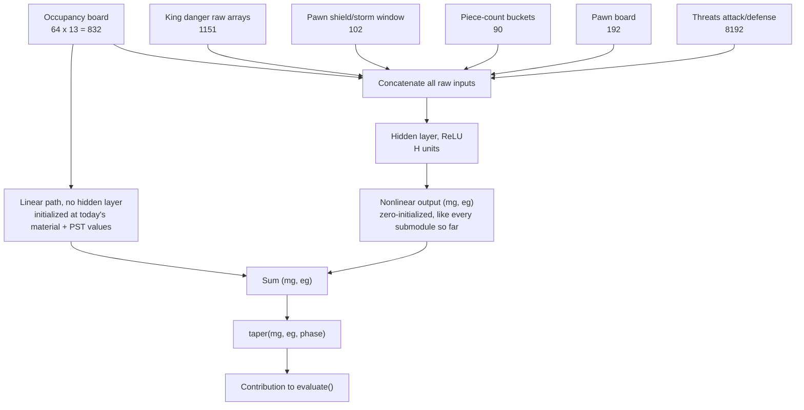

# NNUE-lite architecture sketch (superseded)

**Superseded, 2026-09-15, by `moe.md`.** This sketch's own input design -- concatenate all five
existing submodules' raw arrays (occupancy, king danger, pawn shield/storm, imbalance, pawn board,
threats) into one flat hidden layer -- conflicts with `moe.md`'s later "replace, not layer on top"
decision, which retires the submodule-per-feature decomposition entirely in favor of one small,
shared, non-king-conditioned board representation feeding a router and 8 experts. This document
predates that decision and was never updated to reconcile with it.

One real point from this sketch survives as `moe.md`'s own open question 4, not otherwise lost:
whether the linear material/PST bypass idea below (skip the nonlinear layer for an already-linear
function, the same split real Stockfish NNUE uses for its own PSQT readout) should be folded into
the MoE trunk's own output. Kept here for that reasoning and the mermaid diagram; not a live
architecture candidate otherwise. Ask to move this file to `claude/archived/` once confirmed.

---

A visual aid for the merged-network discussion in `learned-evaluation.md` -- specifically, why
material/PST need a direct linear path rather than being routed through the nonlinear hidden
layer. Not a settled design yet; sizes and which submodules' raw arrays actually get concatenated
are still open questions from the ongoing "which features do they imply" pass over
`stockfish-eval-terms.md`.

**The point of the split**: a ReLU hidden layer can represent a linear function (like material,
`value = sum of weight[piece_type_at_square]`) only by spending two hidden units per input
dimension to reconstruct it (`relu(x) - relu(-x) = x`). Giving material/PST a direct linear
connection from the occupancy board to the output, running alongside the nonlinear path rather
than through it, avoids wasting hidden-layer capacity rebuilding something that was already free.
Real Stockfish NNUE does the same thing: its feature transformer output feeds both a small linear
"PSQT" readout and the deep nonlinear stack, and the two are added together.

**Two independent things get summed before `taper`**:
- The linear path's `(mg, eg)`, seeded at today's real `piece_value`/PST numbers (founded, not
  zero -- material/PST already have a citable source, unlike most submodule weights).
- The nonlinear path's `(mg, eg)`, zero-initialized like every submodule built so far (provably
  no-op until training moves it).
